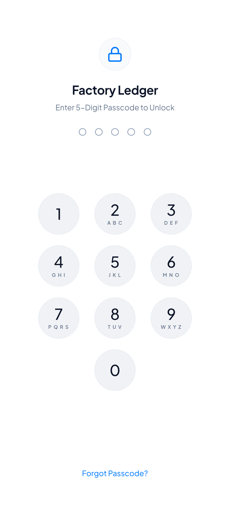
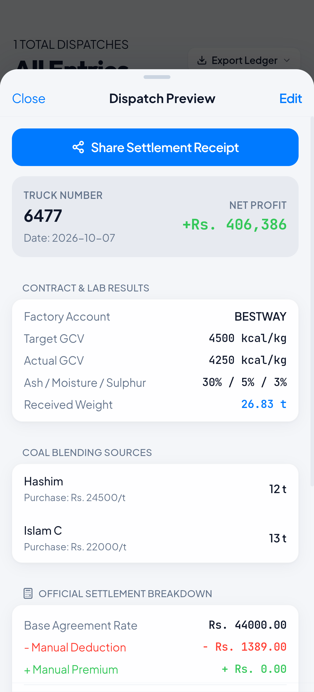
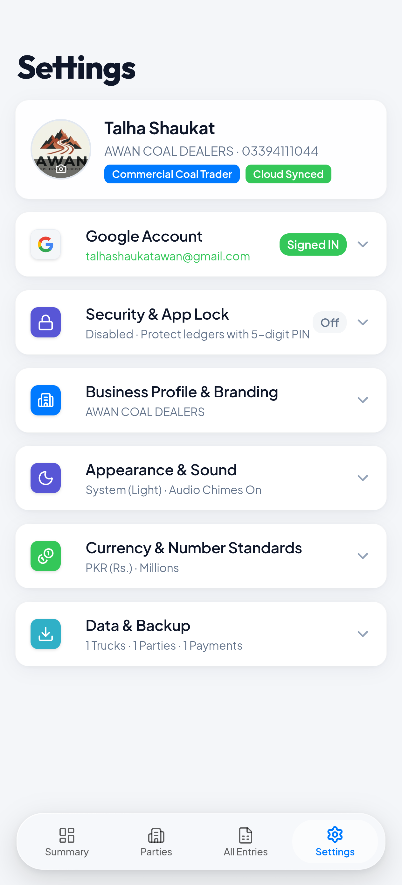
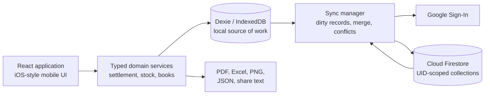

# Factory Ledger

<div align="center">

[](https://github.com/Talhaawan403/Factory-Ledger/actions/workflows/ci.yml)
[](LICENSE)
[](https://react.dev/)
[](https://www.typescriptlang.org/)
[](https://capacitorjs.com/)
[](https://firebase.google.com/)

**Offline-first dispatch, inventory, expense, and party-ledger software for coal trading operations.**

Factory Ledger combines truck dispatch settlement, coal-lot allocation, landed-cost inventory, party accounts, operating expenses, document exports, and optional Firebase synchronization in one mobile-first application.

</div>

> [!IMPORTANT]
> Factory Ledger is suitable for development and supervised pilot use. Automated local checks cover business rules, backups, synchronization logic, Firestore rules, web builds, and Android builds. Before relying on it for production or multi-device accounting, complete the [release gates](#production-release-gates) against the intended Firebase project and real devices.

## Screenshots

<div align="center">
  <table>
    <tr>
      <td align="center" width="33%">
        <strong>App Lock</strong><br />
        <sub>PIN and Android biometrics</sub><br /><br />
        
      </td>
      <td align="center" width="33%">
        <strong>Dispatch Settlement</strong><br />
        <sub>Recipe, quality, weight, and margin</sub><br /><br />
        
      </td>
      <td align="center" width="33%">
        <strong>Settings and Sync</strong><br />
        <sub>Backup, security, and cloud controls</sub><br /><br />
        
      </td>
    </tr>
  </table>
</div>

## What Factory Ledger Does

### Dispatch and settlement

- Records pending and settled truck dispatches with factory, truck, purchase order, recipe, weighbridge, lab, tax, commission, and overhead details.
- Supports multi-source coal recipes and freezes the landed purchase rate on each allocation so later inventory edits cannot silently rewrite historical profit.
- Calculates manual or proportional GCV adjustments, configurable whole-rupee or paisa rounding, tax deduction, payable rate, billed revenue, cost, and margin.
- Separates in-transit cost from recognized settlement revenue: cost posts on the dispatch date; revenue posts only after factory settlement.
- Tracks loaded versus received weight and reports shortage or gain without recognizing provisional revenue.

### Inventory and mine ledgers

- Tracks mines, suppliers, yards, purchase vouchers, billed weight, received weight, loading, freight, and landed cost.
- Treats stock entries as divisible lots, allowing one lot to serve several dispatches while enforcing aggregate allocation limits transactionally.
- Derives remaining quantity and stock value from active dispatch allocations instead of maintaining a fragile mutable stock counter.
- Shows available, partially used, fully used, exhausted, and overdrawn states, including links back to consuming dispatches.
- Locks financial fields once a stock entry is used, preserving the accounting basis of past dispatches.

### Books, parties, and expenses

- Maintains party-specific invoices, payments received, payments paid, and whole-rupee running balances.
- Provides Books totals for inflow, dispatch cost, operating expenses, capital in transit, and net effect.
- Records warehouse rent, labour, utilities, equipment, maintenance, office, transport, and other operating expenses.
- Keeps party balances and independent operating expenses separate so the same cost is not posted twice.
- Offers searchable, period-filtered views across dispatches, payments, expenses, mines, lots, and parties.

### Documents, exports, and recovery

- Generates dispatch advice, settlement receipts, payment receipts, and payment vouchers with explicit accounting states.
- Exports party statements, fleet reports, PDF documents, Excel workbooks, shareable text, and crisp 3x PNG receipts.
- Creates full JSON database backups and validates their schema, values, dates, IDs, relationships, and counts before restore.
- Takes a required pre-restore snapshot and performs database replacement atomically, with rollback on failure.
- Preserves up to 200 synchronization conflict snapshots for export and investigation.

### Offline-first operation and optional cloud sync

- Stores the working ledger locally in IndexedDB through Dexie; the app remains usable without a Firebase account.
- Marks local mutations dirty and synchronizes full entity documents using soft-delete tombstones.
- Uses per-record `updatedAt` timestamps for conflict resolution and archives the losing snapshot instead of discarding it silently.
- Synchronizes parties, dispatches, payments, expenses, purchase orders, stock lots, mines, and shared business settings.
- Supports startup reconciliation, manual Sync Now, and app-wide pull-to-sync. It does not use a live Firestore listener.
- Keeps App Lock credentials, biometrics, theme, and other device-only preferences out of cloud settings.

## Business Rules

Factory Ledger contains configurable business logic, not universal accounting or tax advice. Confirm every rule against the contracts, factory slips, and accounting policy used by the deployment.

### Dispatch settlement

```text
adjusted rate = base rate - GCV deduction + GCV premium

formula-tax option:
tax deduction = adjusted rate × (1 + sales tax %) × income tax %

payable rate  = adjusted rate - tax deduction - commission per ton
revenue       = payable rate × factory received weight
dispatch cost = sum(recipe tons × frozen landed rate) + dispatch overheads
margin        = revenue - dispatch cost
```

Manual per-ton tax is the default for new installations. The built-in formula option defaults to 18% sales tax and 5% income-tax withholding, but both percentages are configurable and saved on the dispatch as historical snapshots.

In proportional GCV mode, the application adjusts the base rate by the ratio between actual and target GCV. The deployment owner must confirm whether premiums above target are allowed, which rounding convention applies, and whether separate moisture, ash, or sulphur penalties must be added.

### Inventory valuation

```text
purchase total = billed weight × purchase rate + loading + freight
landed rate    = purchase total ÷ received weight
remaining tons = received weight - active dispatch allocations
```

Dispatch rows retain the landed rate captured when the lot was selected. Correcting a lot later does not reprice historical dispatches automatically.

### Accounting boundary

Factory Ledger is a commercial single-entry operational ledger, not a double-entry general ledger or statutory tax filing system. Pending dispatch cost appears in Books immediately; corresponding revenue appears only when the dispatch is settled. General expenses affect Books but not a party's invoice/payment balance.

## Architecture



| Layer | Implementation |
| :--- | :--- |
| Application | React 19, TypeScript 6, React Router 7, Vite 8 |
| Interface | Tailwind CSS 4, shared iOS-style controls, Lucide icons, light/dark themes |
| Local data | Dexie 4 over IndexedDB |
| Cloud | Firebase Authentication and Cloud Firestore |
| Android | Capacitor 8, native biometric plugin, Android SDK 36 |
| Documents | ExcelJS, jsPDF, jsPDF AutoTable, html2canvas |
| Quality gates | oxlint, TypeScript, Vitest, Firebase Emulator Suite, Gradle, apksigner |

## Getting Started

### Prerequisites

- Node.js `^20.19.0` or `>=22.12.0`
- npm 10 or a compatible npm version
- JDK 21 or newer for Firestore emulator and Android tasks
- Android Studio and Android SDK 36 for native builds
- A Firebase project only if cloud sync and Google Sign-In are required

### Install and run locally

```bash
git clone https://github.com/Talhaawan403/Factory-Ledger.git
cd Factory-Ledger
npm ci
npm run dev
```

Open `http://localhost:5173`.

The app starts in offline-only mode when Firebase environment variables are absent. Data stays in that browser profile's IndexedDB, so create a JSON backup before clearing site data or changing profiles.

## Firebase Setup

Cloud sync is optional. Do not deploy against production data until the emulator tests and live acceptance checks pass.

1. Create a Firebase project.
2. Enable Google as an Authentication provider.
3. Create a Cloud Firestore database.
4. Copy the example environment file:

   ```bash
   cp .env.example .env
   ```

5. Fill in the Firebase web application values:

   ```dotenv
   VITE_FIREBASE_API_KEY=your_firebase_api_key
   VITE_FIREBASE_AUTH_DOMAIN=your_project_id.firebaseapp.com
   VITE_FIREBASE_PROJECT_ID=your_project_id
   VITE_FIREBASE_STORAGE_BUCKET=your_project_id.firebasestorage.app
   VITE_FIREBASE_MESSAGING_SENDER_ID=your_messaging_sender_id
   VITE_FIREBASE_APP_ID=your_app_id
   VITE_FIREBASE_MEASUREMENT_ID=your_measurement_id
   ```

6. Run the Firestore rules against the local demo emulator:

   ```bash
   npm run test:rules
   ```

7. Review `firestore.rules`, then deploy the exact tested file to the intended Firebase project:

   ```bash
   firebase deploy --only firestore:rules --project YOUR_PROJECT_ID
   ```

8. Confirm owner access, cross-user denial, malformed-record denial, sync counts, and a fresh-device restore against the deployed project.

Firebase web configuration values identify the Firebase project; they are not a substitute for Firestore authorization. The security boundary is the deployed rules plus authenticated UID ownership.

### Android Google Sign-In

1. Add an Android app in Firebase with package name `com.factoryledger.app`.
2. Register the debug and release SHA-1 and SHA-256 fingerprints.
3. Download `google-services.json` to `android/app/google-services.json`.
4. Keep that file out of version control; it is ignored by this repository.
5. Rebuild and test Google Sign-In using the exact signed APK intended for release.

## Development Commands

| Command | Purpose |
| :--- | :--- |
| `npm run dev` | Start the Vite development server |
| `npm run lint` | Run oxlint |
| `npm run typecheck:tests` | Type-check the test sources |
| `npm run test` | Run unit and regression tests, excluding Firestore rules |
| `npm run test:rules` | Run Firestore security-rule tests in the local emulator |
| `npm run build` | Type-check the app and create the production web bundle |
| `npm run generate:icons` | Regenerate Android launcher and web icon assets |
| `npm run verify:release` | Run release gates, build a signed APK, and verify its signature |

Run the main local verification set with:

```bash
npm run lint
npm run typecheck:tests
npm run test
npm run test:rules
npm run build
```

The Firestore emulator requires JDK 21 or newer. Rules tests use the local `demo-factory-ledger` project and must not point at production data.

## Android Builds

### Debug APK

```bash
npm run build
npx cap sync android
./android/gradlew -p android assembleDebug
```

The APK is written to `android/app/build/outputs/apk/debug/app-debug.apk`.

### Signed release APK

Create `android/keystore.properties` locally:

```properties
storeFile=release.keystore
storePassword=YOUR_KEYSTORE_PASSWORD
keyAlias=factoryledger
keyPassword=YOUR_KEYSTORE_PASSWORD
```

Place the keystore at the path referenced by `storeFile`, then run:

```bash
npm run verify:release
```

The verifier requires JDK 21+, Android build tools with `apksigner`, and valid signing material. It runs lint, test type-checking, unit tests, the production web build, Capacitor synchronization, Gradle release assembly, and APK signature verification. It does not deploy Firestore rules or install the APK on a device.

The signed APK is written to `android/app/build/outputs/apk/release/app-release.apk`.

## Security and Privacy Model

- **Local data:** Ledger records are stored in IndexedDB. They are not encrypted at rest by Factory Ledger.
- **App Lock:** The optional five-digit PIN is a convenience/privacy barrier. Its verifier is derived with PBKDF2 and stored locally; it is not a cloud credential or an encryption key.
- **Biometrics and reset:** Android biometric unlock and Phone Lock confirmation use native OS prompts. Phone Lock can authorize resetting the local App PIN; it cannot authorize cloud access.
- **Cloud identity:** Google/Firebase authentication plus matching UID rules protect cloud collections. Factory Ledger does not require its own second factor. A compromised Google account can expose that account's cloud ledger.
- **Device-only settings:** PIN hashes, biometric state, theme, and local lock preferences are excluded from cloud settings.
- **Backups:** Exported database backups are plaintext JSON. Store and transmit them as sensitive financial documents.
- **Conflict archive:** Losing sync versions are retained locally for investigation and can contain sensitive ledger records.
- **Android release protection:** Release builds disable Android backup and enable secure-window behavior. Debug builds intentionally relax secure-window behavior for testing.
- **Telemetry:** The application does not include an analytics or advertising SDK. Firebase is used only when the deployment configures Authentication and Firestore.

For the full threat boundary and operational guidance, read [docs/SECURITY_MODEL.md](docs/SECURITY_MODEL.md).

## Production Release Gates

Passing CI proves the checked-in code under automated conditions; it does not prove a particular Firebase deployment, account, phone, or signed APK.

Before production or multi-device use, verify all of the following:

- The current `firestore.rules` file is deployed to the intended Firebase project.
- A normal party, mine, lot, purchase order, dispatch, payment, and expense each appear as committed Firestore documents after sync.
- A different authenticated UID and an unauthenticated client cannot read or write the ledger.
- A fresh browser/device restores only after the intended account and restore choice are confirmed.
- Offline create, edit, delete, retry, account-switch, and delete-versus-edit conflict scenarios converge correctly on two real devices.
- Cloud wipe fails closed and leaves local data intact when any remote read, delete, or verification step fails.
- The exact signed release APK passes Google Sign-In, biometrics, Phone Lock PIN reset, export/share, secure-window, and restore checks on the target Android version.
- Representative figures match genuine factory slips, including GCV adjustment, rounding, tax, commission, shortage, blended cost, and settlement totals.
- The business owner or accountant signs off on the accounting dates, tax method, premium/penalty behavior, landed-cost inputs, and negative-stock policy.
- A supervised pilot completes with frequent verified JSON backups and no unexplained balance or stock differences.

## Known Limitations

- Conflict resolution is record-level last-write-wins based on device timestamps. Keep automatic network time enabled.
- Cloud synchronization is periodic/reconciliation-based, not real-time listener push.
- Stock adjustments for shrinkage and physical-count corrections are not yet modeled as a dedicated entity.
- The app does not integrate directly with weighbridge hardware, banking systems, tax portals, or a double-entry general ledger.
- Factory-specific premium, penalty, and rounding rules must be confirmed before operational use.
- A public source repository does not include Firebase credentials, Android signing keys, production data, or a hosted backend.

## Repository Layout

```text
.
├── android/                 Capacitor Android application and native biometric bridge
├── docs/                    Security and cloud rollout documentation
├── public/                  Web icons and static assets
├── scripts/                 Release verification and icon generation
├── src/
│   ├── components/          Shared iOS-style controls, sheets, previews, and receipts
│   ├── hooks/               Ledger and visual-effect hooks
│   ├── lib/                 Dexie persistence, Firebase access, and sync orchestration
│   ├── pages/               Summary, parties, dispatch, inventory, entries, and settings
│   ├── utils/               Accounting, dates, exports, security, and formatting
│   └── types.ts             Domain model
├── tests/                   Unit, regression, backup, sync, and Firestore rules tests
├── firestore.rules          UID-scoped schema and stale-write validation
└── package.json             Scripts and dependency manifest
```

## Contributing

1. Create a focused branch.
2. Keep financial rules in pure, tested helpers instead of duplicating formulas in views or exports.
3. Preserve the existing mobile-first iOS interaction language, accessible 44px touch targets, flat colors, and light/dark support.
4. Add regression coverage for any change to money, stock, backup, restore, synchronization, or security behavior.
5. Run the complete local verification set before opening a pull request.

## License

Factory Ledger is available under the [MIT License](LICENSE).
